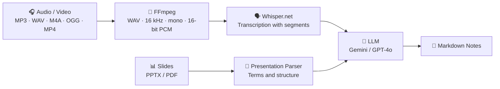
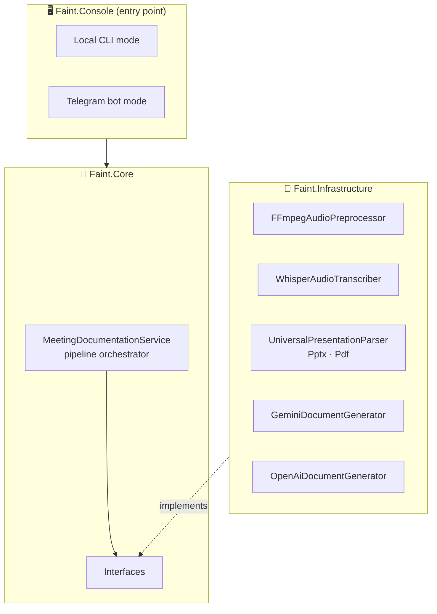

<div align="center">

# 🎓 F.A.I.N.T

### **F**ast **A**cademic **I**nsight & **N**ote **T**ranscription

Turn lecture recordings and slides into structured, exam-ready Markdown notes, automatically.


</div>

---

## 📖 Table of Contents

- [About](#-about)
- [Features](#-features)
- [Pipeline](#-pipeline)
- [Architecture](#-architecture)
- [Output Format](#-output-format)
- [Telegram Bot](#-telegram-bot)
- [Getting Started](#-getting-started)
- [Configuration](#-configuration)
- [Usage](#-usage)
- [Tech Stack](#-tech-stack)
- [Roadmap](#-roadmap)
- [License](#-license)

---

## ✨ About

**F.A.I.N.T** takes a lecture or meeting recording, and optionally its presentation, and uses AI to produce a detailed, well-structured **Markdown document**.

It doesn't just transcribe. It **cross-references what was actually said with the slide text**, so complex terms and formulas are spelled correctly while the content stays faithful to the spoken lecture. The goal: cut down the routine of note-taking, save time, and make exam prep easier.

---

## 🌟 Features

| | Feature | Details |
|---|---|---|
| 🎙️ | **Audio and video input** | MP3, WAV, M4A, OGG, MP4, converted automatically via FFmpeg |
| 🗣️ | **Local speech recognition** | Whisper.net with automatic language detection and segmented output |
| 📥 | **Auto model download** | Fetches `ggml-small.bin` or `ggml-base.bin` if missing |
| 📊 | **Slide parsing** | Reads text from **PPTX** (OpenXml) and **PDF** (PdfPig) |
| 🧠 | **Swappable LLMs** | Google **Gemini** (default) or **OpenAI GPT-4o** |
| 📝 | **Structured notes** | Strict four-section Markdown output |
| 🌐 | **Multilingual output** | English, Russian, Spanish, Kazakh |
| 🤖 | **Telegram bot** | Multi-user sessions, inline dashboard, three ways to upload files |
| 💻 | **Local CLI mode** | Drop in `lecture.mp3` and `presentation.pptx` and get notes in the terminal |

---

## 🔄 Pipeline



1. **Convert**: FFmpeg normalizes any input to the format the speech model expects.
2. **Transcribe**: Whisper turns speech into text, auto-detecting the language.
3. **Parse slides** *(optional)*: text is extracted from PPTX or PDF.
4. **Generate**: the LLM merges transcript and slide vocabulary into a structured document.

---

## 🏛️ Architecture

The solution follows **Clean Architecture** principles, split into three layers:



| Layer | Responsibility |
|-------|----------------|
| **Faint.Core** | Business logic and interfaces. `MeetingDocumentationService` drives the pipeline (convert → transcribe → parse slides → LLM). |
| **Faint.Infrastructure** | FFmpeg, Whisper, LLM clients, and file parsers. |
| **Faint.Console** | Entry point. Choose between local CLI and Telegram bot. |

---

## 📋 Output Format

A carefully engineered system prompt makes the model:

- Be **exhaustive** and not drop details from the second half of the lecture
- Use slide text **only as a glossary and structural guide**, relying primarily on the audio
- Produce a strict structure:

```markdown
# 1. Executive Summary
# 2. Key Topics & Detailed Insights
# 3. Core Takeaways
# 4. Action Items & Next Steps
```

| Generator | Model | Temperature |
|-----------|-------|-------------|
| `GeminiDocumentGenerator` *(default)* | Gemini Flash, called over HTTP with an API key | `0.1` |
| `OpenAiDocumentGenerator` | `gpt-4o` | `0.3` |

Low temperatures keep the notes precise and faithful to the source.

---

## 🤖 Telegram Bot

Launch the app in bot mode for a friendly, multi-user experience powered by `TelegramBotHandler`.

- **Concurrent sessions**: each user has an isolated session (`Idle` / `Processing`) stored in a `ConcurrentDictionary`; extra requests are blocked while a document is being generated
- **Interactive dashboard**: `/start` shows inline buttons and the current status (audio uploaded? presentation uploaded? language selected?)
- **Language switch**: tap **🌐 Change Language** to pick the output language
- **Three ways to upload files:**

| Method | How | Notes |
|--------|-----|-------|
| 📤 **Direct upload** | Send a voice message, audio, or document | Telegram API limit: **20 MB** |
| 🔗 **URL** | Send a link starting with `http://` | The bot downloads the file to a temp folder via `HttpClient`; ideal for large files |
| 💾 **Local path** | Drag a file into the chat or paste its path | Works when running locally (e.g. on a Mac) |

- **Result delivery**: the notes are saved as a temporary `.md` file and sent back as a document

---

## 🚀 Getting Started

### Prerequisites

- [.NET SDK 10](https://dotnet.microsoft.com/download)
- [FFmpeg](https://ffmpeg.org/download.html) available on your `PATH`
- A **Gemini** and/or **OpenAI** API key
- A **Telegram bot token** (via [@BotFather](https://t.me/BotFather)) if using bot mode

### Install and run

```bash
git clone https://github.com/Nika-nerd/Faint.git
cd Faint
dotnet restore
dotnet run --project Faint.Console
```

On first launch, the required Whisper model is downloaded automatically.

---

## ⚙️ Configuration

Provide your keys through configuration or environment variables (names below are illustrative; match them to your project):

```json
{
  "Gemini": { "ApiKey": "<your-gemini-key>" },
  "OpenAI": { "ApiKey": "<your-openai-key>" },
  "Telegram": { "BotToken": "<your-bot-token>" }
}
```

> 🔒 Never commit real keys. Prefer [User Secrets](https://learn.microsoft.com/aspnet/core/security/app-secrets) or environment variables.

---

## 💡 Usage

### Local test mode

Place these files next to the executable:

```text
lecture.mp3
presentation.pptx (or .pdf)
```

Run the app in local mode and the finished Markdown notes are printed straight to your terminal.

### Telegram mode

1. Start the app and choose **Telegram bot**.
2. Open your bot and send `/start`.
3. Upload audio (and optionally slides), pick a language, and start processing.
4. Receive your `.md` notes as a document. ☕

---

## 🧰 Tech Stack

| Area | Technology |
|------|-----------|
| Language and runtime | C#, .NET 10 |
| Audio processing | FFmpeg |
| Speech-to-text | Whisper.net (`ggml-small` / `ggml-base`) |
| PPTX parsing | DocumentFormat.OpenXml |
| PDF parsing | UglyToad.PdfPig |
| LLMs | Google Gemini, OpenAI GPT-4o |
| Interface | CLI, Telegram Bot API |

---

## 🗺️ Roadmap

- [ ] Documentation in more languages
- [ ] Database to cache results, so identical lectures submitted by different students aren't regenerated
- [ ] Fully asynchronous processing
- [ ] Web interface

---

## 📄 License

Distributed under the license of your choice. Add a `LICENSE` file and update this section.

---

<div align="center">

**Less note-taking. More learning.** 🎓

</div>
